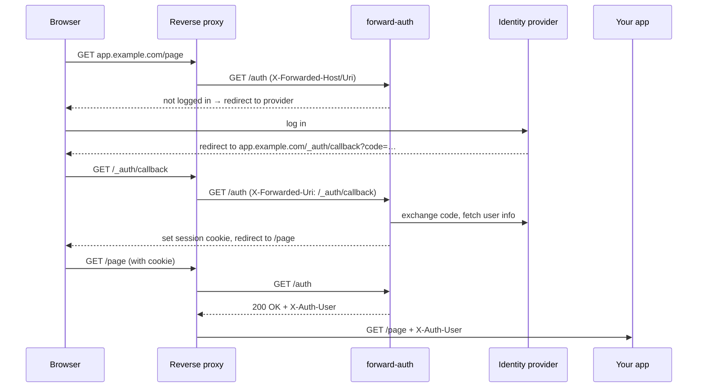

# forward-auth

[](https://github.com/mkuhlmann/forward-auth/actions/workflows/main.yml)
[](LICENSE.md)

**Put a login in front of any web app — with zero dependencies.**

forward-auth is a tiny OAuth 2.0 / OpenID Connect gatekeeper for reverse proxies like [Traefik](https://doc.traefik.io/traefik/middlewares/http/forwardauth/) and [nginx](http://nginx.org/en/docs/http/ngx_http_auth_request_module.html). Your proxy asks forward-auth "is this request logged in?" — forward-auth answers, and sends the user to your identity provider if not. Your apps don't need to know anything about authentication.

## Why forward-auth?

- 📦 **Zero dependencies.** No npm packages at runtime — only what ships with [Bun](https://bun.com): `Bun.serve`, `fetch` and `crypto`. Nothing to audit but Bun itself, no supply chain to worry about.
- 🪶 **Minimal by design.** About 800 lines of readable TypeScript in four files. The production image runs a single minified 20 KB bundle with a bytecode cache for fast startup.
- 🗄️ **Stateless.** Sessions live in signed cookies. No database, no Redis, nothing to back up — restart or scale it freely.
- 🔌 **Works with any provider.** Google, Keycloak, Authentik, Authelia, Zitadel, Entra ID, … — any OAuth 2.0 provider whose user info endpoint returns a `sub`. Point it at an OIDC discovery URL and you're done.

## Features

- **OIDC discovery** — configure a single `DISCOVERY_URL` instead of three endpoints
- **Access control** — restrict each service to a list of allowed users
- **One instance, many services** — override settings per service through the middleware URL
- **Centralized callback** — register a single redirect URI with your provider for all services
- **User info for your app** — the user's identity is passed on as `X-Auth-User` and `X-Auth-Info` headers
- **Logout** — `/_auth/logout` on any protected service, optionally chained to your provider's logout
- **Secure defaults** — host-bound, tamper-proof, expiring sessions; `HttpOnly`, `Secure`, `SameSite=Lax` cookies; non-root container

## How it works



Every request is checked through the proxy, so forward-auth also sees `/_auth/callback` and `/_auth/logout` on each protected domain — no extra routes needed.

## Quick start

Register `https://private.example.com/_auth/callback` as a redirect URI with your identity provider, then:

```yaml
services:
  traefik:
    image: traefik:v3
    command:
      - '--providers.docker=true'
      - '--providers.docker.exposedbydefault=false'
      - '--entrypoints.web.address=:80'
    ports:
      - 80:80
    volumes:
      - /var/run/docker.sock:/var/run/docker.sock:ro

  forward_auth:
    image: ghcr.io/mkuhlmann/forward-auth
    restart: unless-stopped
    environment:
      - APP_KEY=CHANGE_ME # at least 32 random characters: openssl rand -hex 32
      - DISCOVERY_URL=https://idp.example.com
      - CLIENT_ID=clientid
      - CLIENT_SECRET=verysecret
    # no ports and no traefik labels: only Traefik talks to forward-auth

  whoami:
    image: traefik/whoami
    labels:
      - 'traefik.enable=true'
      - 'traefik.http.routers.whoami.rule=Host(`private.example.com`)'
      - 'traefik.http.routers.whoami.entrypoints=web'
      - 'traefik.http.routers.whoami.middlewares=forward_auth'
      - 'traefik.http.middlewares.forward_auth.forwardauth.address=http://forward_auth:8080/auth?allowed_users=ALLOWED_USER_SUB'
      - 'traefik.http.middlewares.forward_auth.forwardauth.authResponseHeaders=X-Auth-User,X-Forwarded-User,X-Auth-Info'
```

Open `https://private.example.com` and you'll be sent to your provider to log in.

> [!NOTE]
> This example uses plain HTTP for brevity. Cookies are `Secure` by default, so put TLS in front of it (or set `COOKIE_INSECURE=true` for local testing).

<details>
<summary><b>nginx example</b></summary>

nginx's `auth_request` only understands `2xx`, `401` and `403`, so set `REDIRECT_CODE=403` and let nginx perform the redirect:

```nginxconf
server {
	listen 443 ssl;
	http2 on;
	server_name private.example.com;

	location = /auth {
		internal;
		proxy_pass http://forward_auth:8080;
		proxy_pass_request_body off;
		proxy_set_header Content-Length "";
		proxy_set_header Host $host;
		proxy_set_header X-Forwarded-For $remote_addr;
		proxy_set_header X-Forwarded-Host $host;
		proxy_set_header X-Forwarded-Proto $scheme;
		proxy_set_header X-Forwarded-Uri $request_uri;
	}

	location @auth_redirect {
		add_header Set-Cookie $auth_cookie;
		return 302 $auth_location;
	}

	location @auth_denied {
		default_type text/plain;
		return 401 'unauthorized';
	}

	location / {
		auth_request /auth;
		auth_request_set $auth_location $upstream_http_location;
		auth_request_set $auth_cookie $upstream_http_set_cookie;
		auth_request_set $auth_user $upstream_http_x_auth_user;
		auth_request_set $auth_info $upstream_http_x_auth_info;
		add_header Set-Cookie $auth_cookie;

		error_page 403 = @auth_redirect;
		error_page 401 = @auth_denied;

		proxy_set_header X-Auth-User $auth_user;
		proxy_set_header X-Auth-Info $auth_info;
		proxy_set_header Host $host;
		proxy_pass http://upstream;
	}
}
```

</details>

## Passing the user to your app

When a request is authenticated, forward-auth responds with these headers. Tell your proxy to forward them (`authResponseHeaders` in Traefik, `auth_request_set` in nginx):

| Header             | Content                                                  |
| ------------------ | -------------------------------------------------------- |
| `X-Auth-User`      | The user's `sub` (unique ID at your provider)            |
| `X-Forwarded-User` | Same as `X-Auth-User`, for apps that expect this name    |
| `X-Auth-Info`      | The full user info response as JSON (`name`, `email`, …) |

Sessions are stored in a signed cookie, which browsers limit to 4 KB. If the user info is too large, the biggest claims (e.g. a long `groups` list) are left out; `sub` is always kept.

## Configuration

All options are set through environment variables. Options marked **per service** can also be overridden as query parameters in the middleware URL, so one instance can protect many services with different rules:

```
http://forward_auth:8080/auth?allowed_users=alice,bob&scopes=openid%20email
```

### Required

| Variable        | Description                                                                  |
| --------------- | ---------------------------------------------------------------------------- |
| `APP_KEY`       | Secret for signing cookies and tokens, at least 32 characters                |
| `CLIENT_ID`     | OAuth client ID · _per service_                                              |
| `CLIENT_SECRET` | OAuth client secret · _per service_                                          |
| `DISCOVERY_URL` | OIDC issuer URL, e.g. `https://accounts.google.com` · _per service_          |
| _or_            | `AUTHORIZE_URL`, `TOKEN_URL` and `USERINFO_URL` individually · _per service_ |

With `DISCOVERY_URL`, the endpoints are read from `/.well-known/openid-configuration` (cached for an hour). Explicitly set endpoint URLs take precedence. The user info endpoint must return a `sub` field.

### Access & sessions

| Variable          | Description                                                                          | Default        |
| ----------------- | ------------------------------------------------------------------------------------ | -------------- |
| `ALLOWED_USERS`   | Comma-separated `sub` values allowed in; empty allows everyone · _per service_       | everyone       |
| `SCOPES`          | Space-separated OAuth scopes, e.g. `openid email profile` · _per service_            |                |
| `COOKIE_NAME`     | Name of the session cookie                                                           | `__auth`       |
| `COOKIE_AGE`      | Inactivity timeout in seconds, renewed with every request                            | `604800` (7 d) |
| `SESSION_MAX_AGE` | Absolute session lifetime in seconds — users log in again after this, however active | `604800` (7 d) |
| `COOKIE_INSECURE` | Set to `true` to allow cookies over plain HTTP (development only)                    | `false`        |
| `LOGOUT_URL`      | Where to send users after logout, e.g. your provider's logout page · _per service_   | service root   |

### Server

| Variable        | Description                                                           | Default   |
| --------------- | --------------------------------------------------------------------- | --------- |
| `LISTEN_HOST`   | Address to bind                                                       | `0.0.0.0` |
| `LISTEN_PORT`   | Port to bind                                                          | `8080`    |
| `REDIRECT_CODE` | Status code for login redirects; use `403` with nginx · _per service_ | `302`     |
| `LOG_LEVEL`     | `DEBUG`, `INFO`, `WARN`, `ERROR` or `NONE`                            | `INFO`    |

### Centralized callback

| Variable                   | Description                                                                                     | Default |
| -------------------------- | ----------------------------------------------------------------------------------------------- | ------- |
| `CALLBACK_PORT`            | Port of the callback server; the feature is off when unset                                      |         |
| `CALLBACK_URL`             | Public URL of the callback server, e.g. `https://auth.example.com/callback`                     |         |
| `CALLBACK_ALLOWED_DOMAINS` | Comma-separated domains logins may be handed back to; `example.com` includes all its subdomains |         |
| `CALLBACK_CENTRALISED`     | Set to `false` to use per-domain callbacks for a service · _per service_                        | `true`  |

## Logout

Link to `/_auth/logout` on any protected service. forward-auth clears the session and redirects to `LOGOUT_URL`, or to the root of the service.

Your identity provider usually still remembers the user, so without `LOGOUT_URL` they'll often be logged straight back in. Point `LOGOUT_URL` at your provider's logout page to end both sessions.

## Centralized callback

By default, each protected domain receives its own login callback (`https://app.example.com/_auth/callback`), so every domain must be registered as a redirect URI with your provider. With many services, that gets tedious.

The centralized callback runs a second, small server that receives **all** logins at one URL and hands each one back to the right domain:

```yaml
forward_auth:
  image: ghcr.io/mkuhlmann/forward-auth
  environment:
    - APP_KEY=CHANGE_ME
    - DISCOVERY_URL=https://idp.example.com
    - CLIENT_ID=clientid
    - CLIENT_SECRET=verysecret
    - CALLBACK_PORT=8081
    - CALLBACK_URL=https://auth.example.com/callback
    - CALLBACK_ALLOWED_DOMAINS=example.com
  labels:
    # expose only the callback server, never port 8080
    - 'traefik.enable=true'
    - 'traefik.http.routers.auth-callback.rule=Host(`auth.example.com`)'
    - 'traefik.http.routers.auth-callback.service=auth-callback'
    - 'traefik.http.services.auth-callback.loadbalancer.server.port=8081'
```

Register `https://auth.example.com/callback` as the only redirect URI.

1. A user opens `app.example.com`; forward-auth redirects them to the provider with `CALLBACK_URL` as redirect URI
2. After login, the provider sends them to `auth.example.com/callback`
3. The callback server exchanges the code, fetches the user info and redirects back to `app.example.com/_auth/callback` with a short-lived signed token
4. forward-auth verifies the token against the user's pending login, sets the session cookie on `app.example.com` and redirects to the original page

Per-service settings such as `allowed_users` are still enforced in step 4.

> [!IMPORTANT]
> Always set `CALLBACK_ALLOWED_DOMAINS`. It ensures the callback server only ever hands a login back to your own domains.

## Security

forward-auth is designed to be safe by default, but it relies on your proxy being configured correctly:

> [!WARNING]
> **Never expose forward-auth's port 8080 to clients.** It trusts the query parameters of `/auth` (which can change the provider endpoints and allowed users) and the `X-Forwarded-*` headers. Anyone who can reach it directly can forge logins. Only your reverse proxy should talk to it, and the proxy must **overwrite** `X-Forwarded-Host`, `X-Forwarded-Proto` and `X-Forwarded-Uri` instead of passing on client values. Traefik does this automatically; the nginx example above sets them explicitly.

What forward-auth takes care of:

- Sessions are **bound to the domain** they were issued for, and `allowed_users` is checked on **every request** — a cookie from one service can't be reused on another
- Cookies and tokens are **signed (HMAC-SHA256)**, separated by purpose and always **expire**
- Login **CSRF protection** through a state nonce tied to the session cookie
- Secrets and authorization codes are **redacted from logs**; auth responses are never cached

Found a vulnerability? Please report it privately to the maintainer instead of opening a public issue.

## Development

Everything uses Bun's built-in tooling — no TypeScript compiler, formatter or test framework to install:

```sh
bun install    # type definitions only
bun test       # run the test suite
bun check      # type check
bun fmt        # format
bun run build  # build dist/server.js, as used in the Docker image
```

The code lives in [`src/`](src): `ForwardAuth.ts` contains the whole auth flow, `index.ts` reads the configuration.

## Contributing

Pull requests are _very_ welcome! Please keep the spirit of the project: no runtime dependencies, small and readable code.

## License

[MIT](LICENSE.md)
